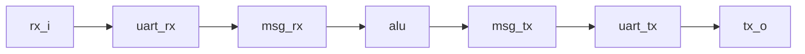

# UART Hesap Makinesi — AnadoLogic 2024 Staj Görevi

AnadoLogic'in 2024 staj alımında verdiği görevin VHDL ile çözümü. Modül, UART'tan
gelen 8 baytlık mesajdaki iki 16-bit sayıyı toplar ya da çıkarır ve sonucu 5
baytlık bir cevap mesajıyla geri gönderir.

- Görev: [docs/task.md](docs/task.md) ([orijinal PDF](docs/berk_muammer_kuzu_task.pdf))
- Dil: VHDL-2008
- Doğrulama: GHDL 6.0.0 ve Questa Sim-64 10.7c

## Protokol

**Gelen mesaj (8 bayt)**

| Header | Num1 | Num2 | Opcode | Checksum |
| --- | --- | --- | --- | --- |
| `BA CD` | 2 bayt, 2's complement | 2 bayt, 2's complement | `00` toplama, `01` çıkarma | 1 bayt |

**Cevap (5 bayt)**

| Header | Result | Checksum |
| --- | --- | --- |
| `AB CD` | 2 bayt, 2's complement | 1 bayt |

İki mesajda da checksum dahil bütün baytların toplamı mod 256 = `0x00` olur.
Çok baytlı alanlarda önce yüksek bayt gönderilir. UART formatı 8N1'dir.

| Gelen | Cevap | İşlem |
| --- | --- | --- |
| `BACD001000200049` | `ABCD003058` | 16 + 32 = 48 |
| `BACD001000200148` | `ABCDFFF099` | 16 − 32 = −16 |

## Mimari



| Modül | Görev |
| --- | --- |
| [`top`](rtl/top.vhd) | Üst modül, blokları birbirine bağlar |
| [`uart_rx`](rtl/uart_rx.vhd) | 8N1 alıcı: 2-FF senkronizer, bit ortasında örnekleme |
| [`msg_rx`](rtl/msg_rx.vhd) | Header arar, alanları toplar, checksum'ı kontrol eder |
| [`alu`](rtl/alu.vhd) | Opcode'a göre toplama veya çıkarma |
| [`msg_tx`](rtl/msg_tx.vhd) | 5 baytlık cevabı checksum ile hazırlar |
| [`uart_tx`](rtl/uart_tx.vhd) | 8N1 verici, `valid`/`ready` el sıkışması |
| [`msg_pkg`](rtl/msg_pkg.vhd) | Header ve opcode sabitleri |

`top` generic'leri `G_CLK_FREQ` (varsayılan 100 MHz) ve `G_BAUD_RATE` (varsayılan
115200). Bir bit `G_CLK_FREQ / G_BAUD_RATE` = 868 saat sürer. Tasarım tek saat
alanındadır, `rst` aktif-yüksek senkron resettir.

### Tasarım kararları

Görevde tanımlanmayan durumlar için:

- Checksum'ı hatalı mesaja cevap verilmez; mesaj atılır, alıcı yeniden header arar.
- Opcode `00` ve `01` dışındaysa cevap verilmez.
- Sonuç 16 bittir, taşmada 2's complement kuralıyla sarar (`32767 + 1 = -32768`).
- Header aranırken `BA BA CD` gibi tekrar eden başlangıç doğru yakalanır.
- Stop biti `0` gelen bayt atılır.

## Simülasyon

[tb/tb_top.vhd](tb/tb_top.vhd) kendi kendini kontrol eden bir testbench'tir.
Mesajları 115200 baud UART ile gönderir, `tx_o` hattını çözer ve gelen baytları
beklenen cevapla karşılaştırır. Her test `PASS` veya `FAIL` yazar, en sonda
`TEST PASSED` ya da `TEST FAILED` çıkar.

| # | Test | Gönderilen | Beklenen |
| --- | --- | --- | --- |
| 1 | Toplama 16 + 32 (görev örneği) | `BACD001000200049` | `ABCD003058` |
| 2 | Çıkarma 16 − 32 (görev örneği) | `BACD001000200148` | `ABCDFFF099` |
| 3 | Hatalı checksum | `BACD001000200048` | cevap yok |
| 4 | Negatif sayı −100 + 25 | `BACDFF9C001900C5` | `ABCDFFB5D4` |
| 5 | Taşma 32767 + 1 | `BACD7FFF000100FA` | `ABCD800008` |
| 6 | Bilinmeyen opcode `02` | `BACD000100020274` | cevap yok |
| 7 | Header öncesi çöp bayt, 1000 − (−2000) | `00FFBA` + `BACD03E8F8300165` | `ABCD0BB8C5` |

### GHDL

Git Bash veya Linux terminalinde:

```bash
cd sim/ghdl
bash run.sh
```

`bash run.sh --wave` GTKWave için `tb_top.ghw` dalga dosyasını da yazar.

### Questa / ModelSim

```bash
cd sim/questa
vsim -c -do run.do
```

`vsim -do run.do` GUI'yi açar ve sinyalleri [wave.do](sim/questa/wave.do) ile
dalga penceresine ekler. Questa 10.7c, Türkçe karakter içeren yollarda (örneğin
`Masaüstü`) kütüphane yazamıyor; `run.do` bu durumda `work` kütüphanesini
`%TEMP%` altına koyar.

### Sonuçlar

| Simülatör | Sonuç |
| --- | --- |
| GHDL 6.0.0 | 7/7 PASS, `TEST PASSED` |
| Questa Sim-64 10.7c | 7/7 PASS, `TEST PASSED` |

İki betik de bir test başarısız olursa sıfırdan farklı çıkış koduyla biter.

## Dizin yapısı

```text
2024-ANADOLOGIC-FIRST-INTERNSHIP-ACCEPTANCE-TASK/
├── docs/
│   ├── task.md                      görev metni
│   └── berk_muammer_kuzu_task.pdf   orijinal görev PDF'i
├── rtl/
│   ├── msg_pkg.vhd
│   ├── uart_rx.vhd
│   ├── msg_rx.vhd
│   ├── alu.vhd
│   ├── msg_tx.vhd
│   ├── uart_tx.vhd
│   └── top.vhd
├── tb/
│   └── tb_top.vhd
└── sim/
    ├── ghdl/
    │   └── run.sh
    └── questa/
        ├── run.do
        └── wave.do
```
