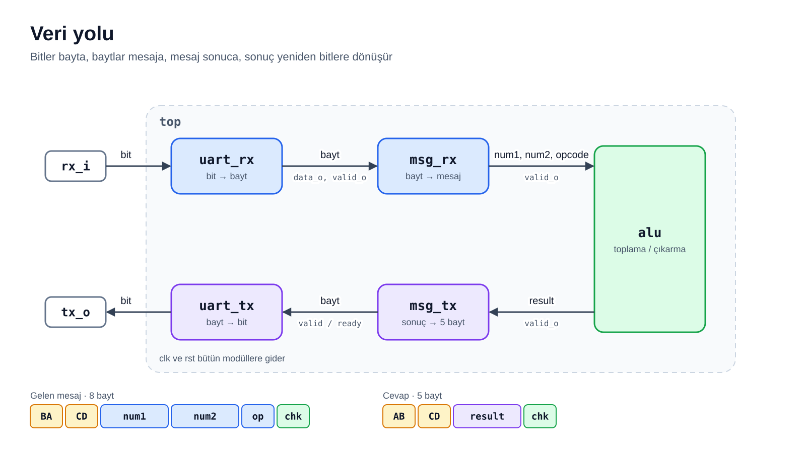
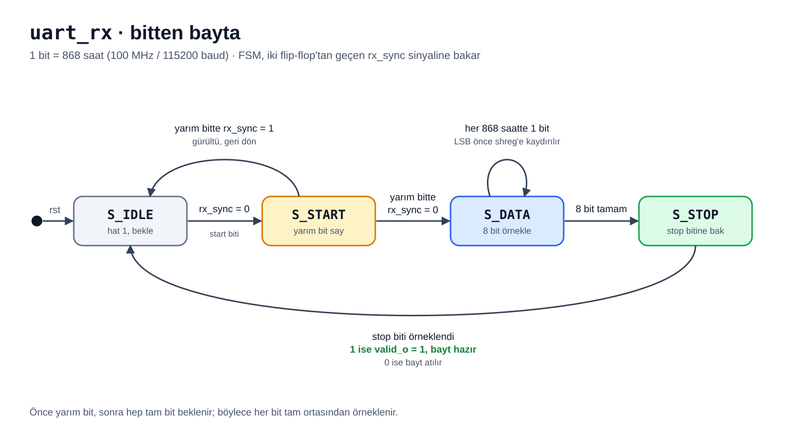
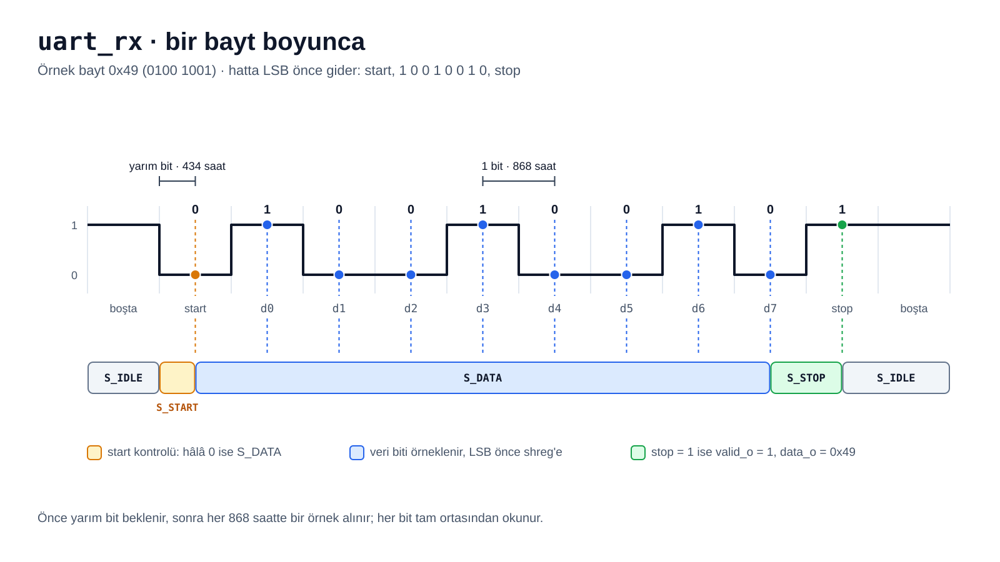
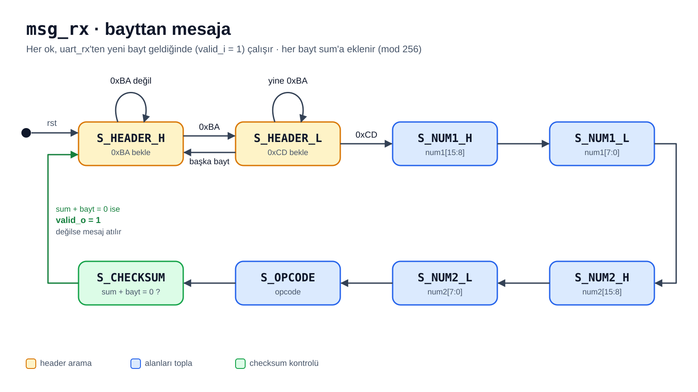
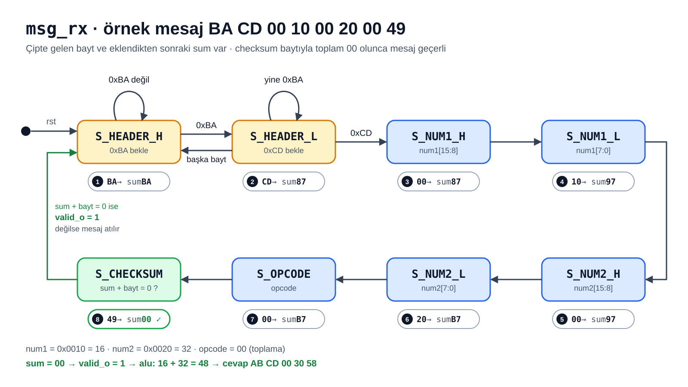
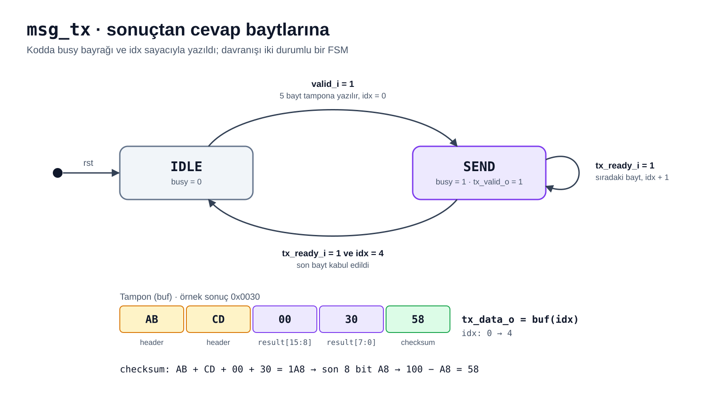
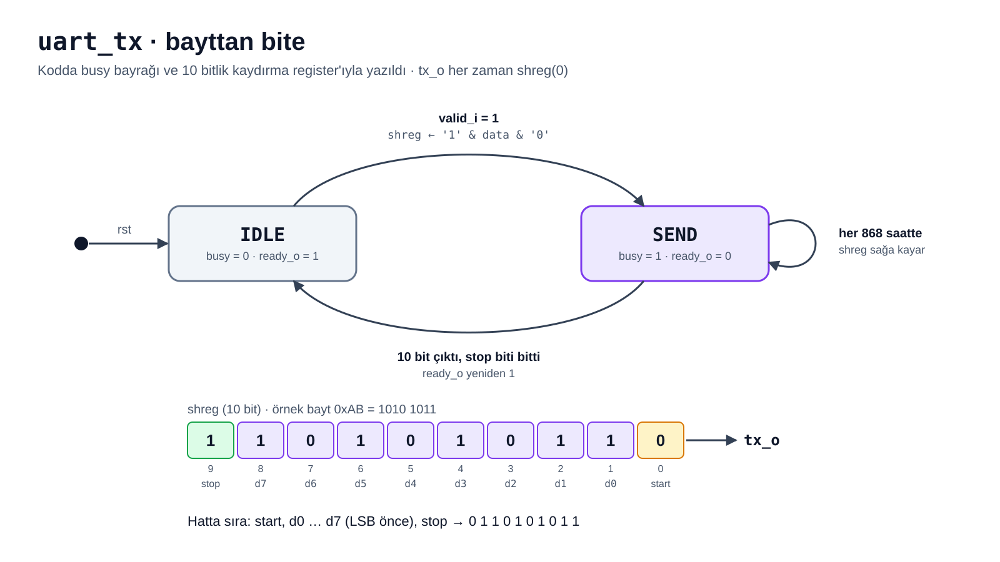

# Durum Makineleri (FSM)

Tasarımda iki açık durum makinesi var: bitleri bayta çeviren `uart_rx` ve baytları
mesaja çeviren `msg_rx`. Gönderme tarafındaki `msg_tx` ve `uart_tx` kodda `busy`
bayrağı ve sayaçla yazıldı; davranışları iki durumlu birer FSM'dir.

## uart_rx: bitten bayta

Varsayılan ayarlarda bir bit 868 saat sürer (100 MHz / 115200). `rx_i` önce iki
flip-flop'tan geçer; FSM senkronlanmış `rx_sync` sinyaline bakar.

| Durum | Ne yapar | Sonraki durum |
| --- | --- | --- |
| `S_IDLE` | Hat boşta (1), start bitini bekler | Hat 0 olunca `S_START` |
| `S_START` | Yarım bit (434 saat) sayar | Hat hâlâ 0 ise `S_DATA`, 1'e döndüyse gürültüdür, `S_IDLE` |
| `S_DATA` | Her bitin ortasında hattı `shreg`'e kaydırır, LSB önce | 8 bit sonra `S_STOP` |
| `S_STOP` | Stop bitinin ortasında hattı kontrol eder | `S_IDLE`; stop biti 1 ise `valid_o = 1`, 0 ise bayt atılır |

Önce yarım bit, sonra hep tam bit beklendiği için her bit tam ortasından örneklenir.
Aşağıda `0x49` baytı alınırken hangi durumun ne zaman aktif olduğu görülüyor:

## msg_rx: bayttan mesaja

Geçişler yalnız `uart_rx`'ten yeni bayt geldiğinde (`valid_i = 1`) olur.

Gelen her bayt 8 bitlik `sum` register'ına eklenir, yani toplam mod 256 tutulur.
Header'ın ilk baytında `sum` baştan başlar. Checksum baytı da eklenince sonuç
`00` ise mesaj geçerlidir; değilse `valid_o` gelmez ve FSM yeniden header arar.

Görevdeki örnek mesaj `BA CD 00 10 00 20 00 49`:

| Bayt | Durum | Yapılan | `sum` |
| --- | --- | --- | --- |
| `BA` | `S_HEADER_H` | Header'ın ilk baytı | `BA` |
| `CD` | `S_HEADER_L` | Header tamam | `87` |
| `00` | `S_NUM1_H` | num1 yüksek bayt | `87` |
| `10` | `S_NUM1_L` | num1 = `0x0010` = 16 | `97` |
| `00` | `S_NUM2_H` | num2 yüksek bayt | `97` |
| `20` | `S_NUM2_L` | num2 = `0x0020` = 32 | `B7` |
| `00` | `S_OPCODE` | opcode = toplama | `B7` |
| `49` | `S_CHECKSUM` | `B7 + 49 = 100`, son 8 bit `00`, `valid_o = 1` | `00` |

Checksum `48` gelseydi son toplam `FF` olurdu; `valid_o` gelmez, cevap gönderilmez.

## alu

FSM değildir. `valid_i` geldiği saatte opcode `00` ise toplar, `01` ise çıkarır ve
`valid_o` verir. Başka opcode'da `valid_o` gelmez.

## msg_tx: sonuçtan cevap baytlarına

`valid_i` gelince `AB`, `CD`, sonucun iki baytı ve checksum bir tampona yazılır.
`SEND` durumunda `tx_valid_o = 1` olur; `uart_tx` bir baytı kabul ettiğinde
(`tx_ready_i = 1`) sıradaki bayta geçilir.

## uart_tx: bayttan bite

Bayt, `'1' & data & '0'` olarak 10 bitlik kaydırma register'ına yüklenir; `tx_o`
bu register'ın 0. bitidir. Hatta sırasıyla start biti (0), 8 veri biti (LSB önce)
ve stop biti (1) görünür. `IDLE` durumunda hat 1'dedir ve `ready_o = 1`.
